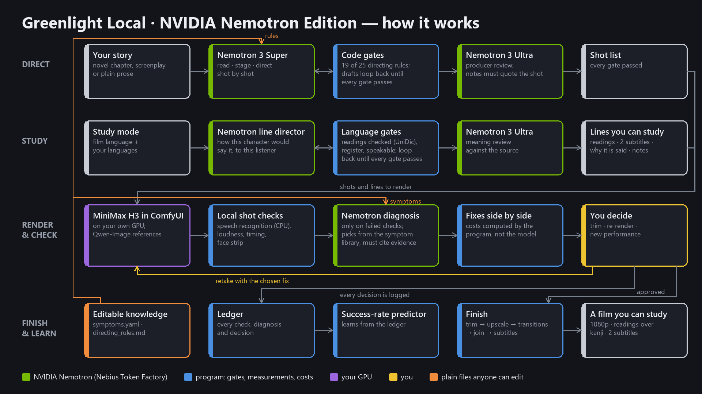
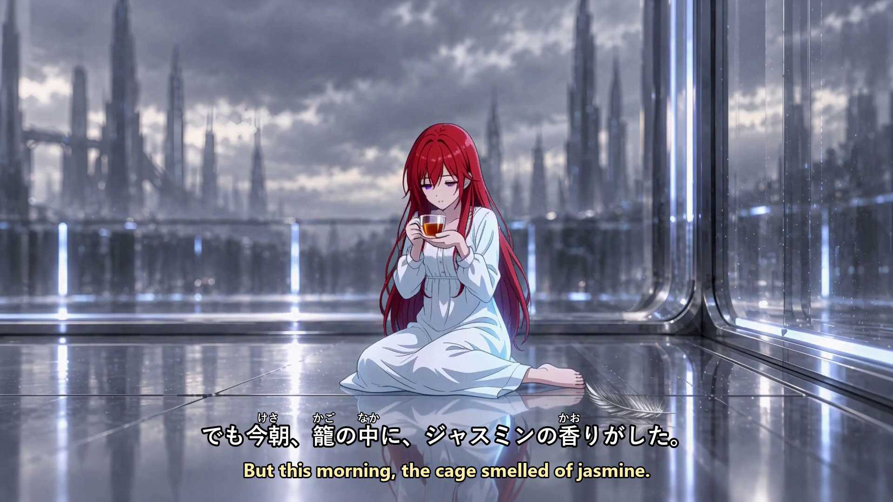
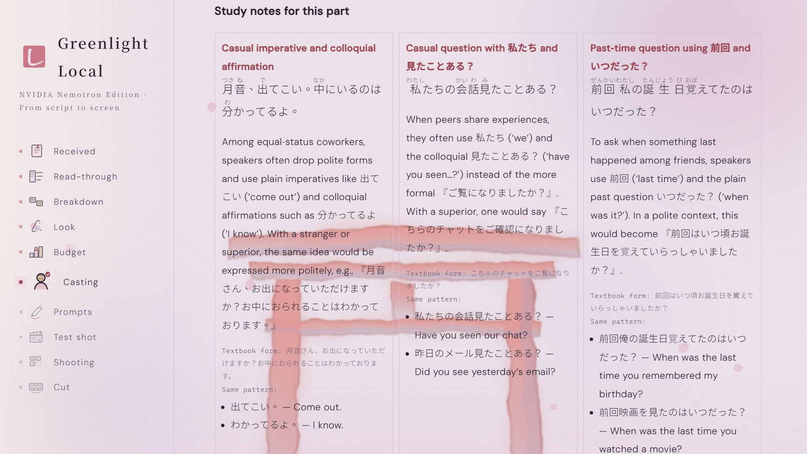

# 🎬 Greenlight Local · NVIDIA Nemotron Edition

**Drop in a story. Get an anime you can learn a language from: directed by NVIDIA Nemotron, rendered
on your own computer, and checked shot by shot before anyone watches it.**

---

## 💡 Why I built this

I grew up watching anime. When I set out to learn Japanese, I hit the wall every learner knows: the
middle. Textbooks were too easy and real shows were too fast. Listening and speaking practice turned into
a chore, and I spent more time hunting for material than studying it. Videos with Japanese and my own
language side by side were rare, and even those never put readings over the kanji, so I kept pausing to
look words up and losing the scene.

So I started making my own. This year, on one laptop GPU, I finished a ten-episode anime series, then
began adapting my own novel into a Japanese anime for learners: four episodes so far, each in a
Japanese–Chinese and a Japanese–English version, with readings over every kanji.

Doing it by hand taught me what it really takes. Not better prompts, but a director's rulebook, the habit
of measuring every shot, and a growing list of what goes wrong and why. Greenlight Local packages all of
it into one app, with NVIDIA Nemotron as the director. A few years ago this needed a studio. Now it needs
a story and a laptop.

---

## 😩 The problem

- **Learners stall in the middle.** Past the beginner stage there is little to practise with: textbook
  dialogue is too easy, native shows are too fast, and bilingual material with readings over the kanji
  barely exists. Learners spend their time searching instead of listening.
- **Translation flattens how people talk.** Machine translation doesn't know who is speaking to whom, so
  a casual line to a friend and a careful one to a boss come out the same, and that is exactly what a
  learner needs to hear.
- **AI video makes clips, not films.** A great eight-second shot is easy now. Turning a story into
  dozens of consistent, well-directed shots still takes a director's judgment most people don't have.
- **When a shot fails, nobody tells you why.** Creators re-roll and hope. Every blind retry costs
  minutes of GPU or dollars of cloud time, and the same mistake comes back next scene.

---

## ✨ What Greenlight Local changes

| Before | With Greenlight Local |
|---|---|
| Hunt for bilingual clips, pause to look up every kanji | Any story you love becomes your own study anime, with readings and two subtitles |
| Flat machine-translated subtitles | Dialogue rewritten for each character and listener, with a note on why it is said that way |
| Write prompts shot by shot | Drop in a novel chapter or screenplay; Nemotron directs the whole scene |
| Re-roll until it looks right | Every shot is measured; failures come with a cited cause and a fix |
| Pay per second in the cloud, upload your story | Render on your own GPU; nothing leaves your machine |
| Know-how lives in one person's head | Rules, checks and the symptom library are files anyone can share and extend |

---

## 🙋 Who it helps

- **Language learners and teachers** who want study material built from stories they actually care
  about, instead of textbook dialogue.
- **Writers and small teams** who want their stories on screen without learning a production pipeline.
- **Studios and creators** who want consistent quality and a record of what works.

---

## ⚙️ How it works



What a learner sees, and the grammar notes behind it:




```
Story ─► Nemotron: read · stage · direct ─► code gates + producer review ─► shot list
                                                                               │
       ledger ◄── person decides ◄── fixes with measured costs ◄── diagnosis ◄─┤
         │                                    (cites evidence)                 ▼
         └──► success-rate prediction       local checks ◄── H3 render (your GPU, ComfyUI)
                                                  │
                    approved shots ──► trim · upscale · transitions · join · subtitles ──► film
```

### 🎬 1. A director with an enforceable rulebook

Nemotron writes the shot list against 25 directing rules distilled from real production. Nineteen are
enforced by code: a line too long for its shot, a speaker who isn't in frame, a line split mid-sentence,
the same action repeated across three shots, shots that never change framing or move the camera. Drafts
loop back with the exact rule and shot until they pass. A larger Nemotron then reviews the cut as a
producer, against the scene's emotional arc. Every producer note must quote words that actually appear
in the shot it names; unsupported notes are discarded automatically.

On my test scene, a ninety-second argument in an office restroom written in Chinese: 20 shots and 154
seconds of screen time, all gates passed in about 12 minutes.

### 📏 2. Every shot is measured

After each render, the app measures the shot instead of asking a model whether it looks fine:

| Check | Measurement |
|---|---|
| Is the line spoken correctly? | Local speech recognition (faster-whisper, run on the CPU so it never competes with rendering for GPU memory) compared with the script |
| Extra speech before the line | Loudness before the first recognized word, which catches what transcripts silently drop |
| Room after the line | Seconds of silence after the last word, so cuts don't clip the speaker |
| Late start | Time to the first word |
| Lip sync | A strip of the speaker's face during the line, for one-click human confirmation |

Thresholds come from the tooling of the production this app grew out of, where each was tuned on real
shots.

### 🩺 3. Diagnosis backed by evidence

When a check fails, Nemotron diagnoses the shot from a **symptom library**: proven causes, each with the
fix, a before-and-after prompt example and where it was verified. It also sees approved shots from the
same scene as a control group. Any diagnosis that doesn't cite a measurement, a person's observation or a
control shot is rejected.

The fixes are laid out side by side, and their costs are computed by the program from the measurements,
not estimated by the model. In one test shot the transcript matched the script perfectly, while the
loudness check found 4.3 seconds of extra, unscripted speech before the line. The app offered:

- **A.** Trim 4.2 seconds. No re-render; the shot goes from 7.3 to 3.1 seconds.
- **B.** Lengthen the shot by a second and re-render.
- **C.** Re-render with a new performance Nemotron wrote so the character speaks sooner.

The person chooses. The choice, the failed checks and the symptom codes are written to the generation
ledger, which drives the success-rate predictor for future shots.

### 👄 4. Control over who speaks

The prompt format names the speaker, the voice and the verb for every line, which drives lip sync.
Leaving the speaker out does the opposite on purpose: the voice plays and the mouth stays closed, three
renders out of three. Shots marked as narration or inner monologue use that form automatically, so inner
voices keep their audio without a silent-track workaround.

### 🈶 5. Study mode: any story becomes a language lesson

Pick the language the film is spoken in (Japanese, Chinese, English or Korean) and the subtitle languages
below it. A **line director** rewrites every line the way this character would say it, at this moment,
to this listener: casual between friends, formal toward a superior, more relaxed as a relationship grows.
Each line gets a register tag, a one-sentence explanation for the learner, subtitles that keep the same
tone, and readings above the kanji. Each part also gets study notes on the most useful patterns.

Code gates keep it correct:

- each rewritten line must quote the source line it replaces, so lines never drift to the wrong speaker
- speech must fit the character (pronouns and register by gender and relationship)
- names stay names, with a per-project name list for readings and English spellings
- private conversation uses natural spoken forms, not written ones
- kanji readings are complete and checked against a Japanese dictionary (fugashi with UniDic)
- every line must be speakable within its shot
- explanations must be in the learner's language

A second Nemotron reviews meaning against the source and flags drift with quotes. Before any gate is
allowed to block, it is validated against 286 Japanese lines from a hand-approved series and must stay
quiet on them.

Study subtitles show the spoken line with readings on top and the learner's language below, timed to
when each line is actually spoken, using word timings from speech recognition.

### 🎞️ 6. Finishing in one pass

Approved shots are trimmed where the checks found extra speech, upscaled to 1080p (RealESRGAN's anime
model for anime styles, fast resampling for photoreal), joined with hard cuts inside a scene and fades
between scenes that only fall on silence, and subtitled. Every step reports progress on screen, and the
upscale step verifies that each shot keeps its exact length.

### 📚 7. Knowledge that grows outside the app

The symptom library and the director's rules are plain files in
`%LOCALAPPDATA%\GreenlightLocal\knowledge`. Teams edit them in any text editor and the next shot uses
the new version, with no restart or rebuild. Broken edits fall back to the default and are reported on the
settings page. The installer is the convenient way to run the system; what makes it better over time
lives in these files and in the ledger.

---

## 🧠 Where Nemotron is used

All reasoning runs on NVIDIA Nemotron through Nebius Token Factory. The model for each step can be
changed on the settings page.

| Step | Default model | What it decides |
|---|---|---|
| Read the script, split into parts | Nemotron 3 Super | Scenes, characters, who speaks |
| Staging | Nemotron 3 Super | Positions, facing, props, which wall each shot sees |
| Director | Nemotron 3 Super | The shot list, revised until every gate passes |
| Producer review | Nemotron 3 Ultra | Notes against the emotional arc, each quoting its shot |
| Line director | Nemotron 3 Super | Spoken lines, readings, subtitles, study notes |
| Meaning review | Nemotron 3 Ultra | Lines whose meaning drifted from the source |
| Shot diagnosis | Nemotron 3 Super | Cause and fix for a failed shot, from the library only |
| Character looks and voice | Nemotron 3 Super | Casting descriptions |
| Subtitle translation | Nemotron 3 Nano | Regular subtitles |

Cloud providers and a cloud video engine are marked "coming soon". This edition runs on Nemotron and
your own GPU.

---

## 🛠️ Built during the hackathon

The original Greenlight was a cloud app released on 2026-08-20, before the hackathon began on 08-26
(archived in [docs/original-greenlight](docs/original-greenlight/README.md)). This edition was built
during the hackathon:

- **10-06 to 10-08** Nemotron director loop, code gates, producer review with quote validation
- **10-09 to 10-10** desktop app, local ComfyUI engine, user API keys, local ledger, staging, local
  casting and reference cards, installer
- **10-15** study mode and the line director, local shot checks, symptom library and diagnosis,
  side-by-side fixes, finishing pipeline, editable knowledge, end-to-end renders through the app

---

## 🚀 Where this is going

I ship updates continuously. The plan:

- **Shared learning.** Opt-in sharing of check results and diagnoses, so a failure solved on one machine
  is prevented on every machine, and the symptom library grows into a community-built manual of how AI
  video behaves.
- **Open framework.** The rules, checks and symptom library as a standard interface any agent or video
  model can plug into. Cloud rendering returns as another engine behind the same checks.
- **Story to series.** Characters, sets and voices consistent across whole seasons, with a production
  plan, budget and schedule generated from the script.
- **The language classroom.** Every language pair, characters who teach the grammar of their own lines,
  and story libraries teachers can assign.
- **Beyond the desktop.** A viewer for phones and tablets, and a studio edition that runs the same
  pipeline on a shared GPU server for teams.

---

## 💻 Running it

**Full pipeline:** Windows 10/11 64-bit, an NVIDIA GPU with 24 GB of memory (developed on an RTX 5090
laptop GPU), 32 GB of RAM or more, at least 50 GB of free disk for ComfyUI and the models, and a Nebius
Token Factory API key.

**Without a GPU:** reading, staging, directing, the line director and the study subtitle preview all
work. Rendering and finishing need the GPU.

From source:

```bash
python -m venv .venv
.venv\Scripts\pip install -r requirements.txt
cd frontend && npm install && npx vite build --outDir ../backend/app/static --emptyOutDir && cd ..
.venv\Scripts\python desktop\launcher.py
```

Open Settings, paste your Nebius key, run the machine check, and let the one-click installer set up
ComfyUI and the models, or point it at a ComfyUI you already run. The speech-recognition model (about
3 GB) downloads the first time a shot is checked.

Rendering takes about 7.5 minutes per 8-second shot on the development GPU. MiniMax H3's license
excludes use in the United States, the European Union, the United Kingdom and South Korea; the app shows
the license and asks for acceptance before installing it. Tested on Windows.

---

## 📄 Licenses

The code is MIT (see [LICENSE](LICENSE)). Models and libraries keep their own licenses:
MiniMax H3 ([license](https://huggingface.co/MiniMaxAI/MiniMax-H3/blob/main/LICENSE), regional
restrictions above), Qwen-Image 2512 and Qwen-Image-Edit 2511 (Apache 2.0), Real-ESRGAN (BSD-3),
faster-whisper and CTranslate2 (MIT), fugashi (MIT) with unidic-lite (UniDic, used under BSD),
pypinyin (MIT), pywebview (BSD-3). NVIDIA Nemotron is used through Nebius Token Factory under its terms.
