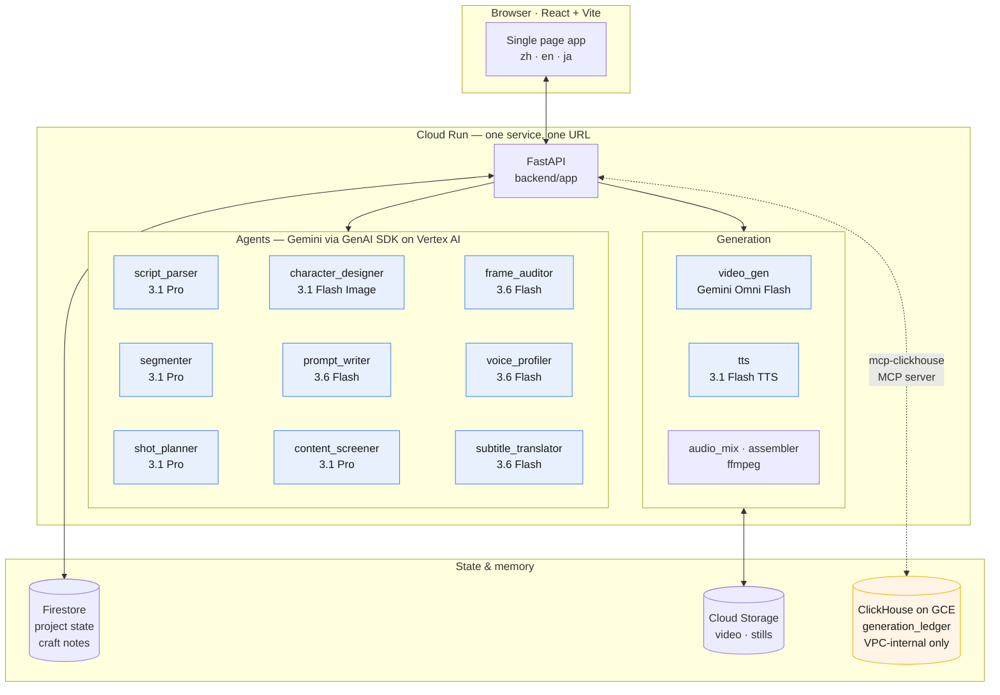
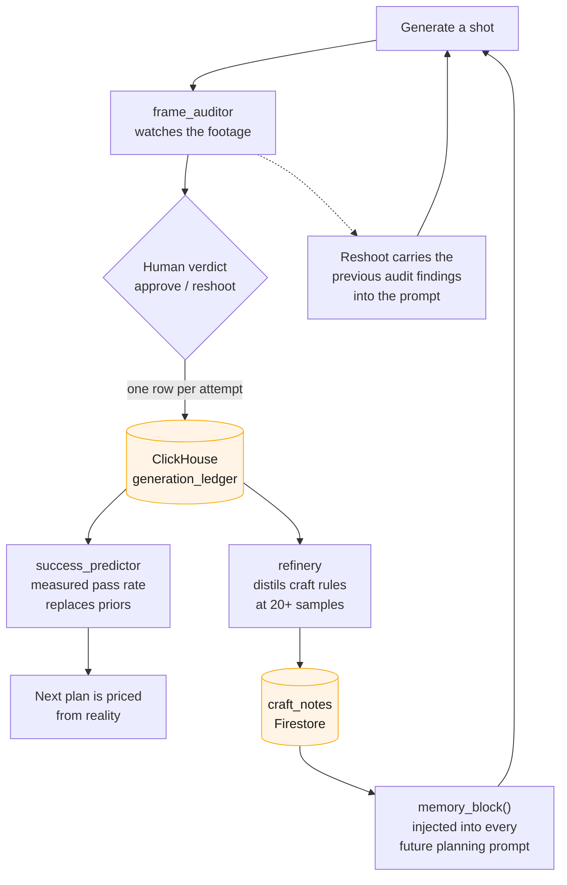
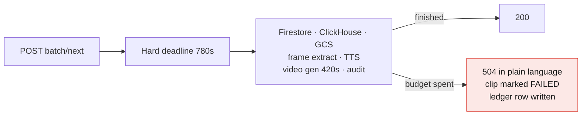

# Greenlight — Architecture

A screenplay goes in. A shot-by-shot production plan comes out, with real cost and
success-rate numbers attached. The human approves at each gate; the agents do the work.

Everything below runs on Google Cloud. Every AI call is a Google model.

---

## 1. The whole system

**Why one Cloud Run service**: frontend and backend ship together, so there is exactly
one URL and one deploy. No CORS, no second thing to keep in sync.

**Why ClickHouse is reached through an MCP server** and not a direct driver: it is a
contest requirement for the ClickHouse track, and it turned out to be the right shape
anyway — `services/clickhouse_mcp.py` is a shim whose interface matches the old direct
driver, so no query site had to change.

**Why ClickHouse is self-hosted on GCE** rather than ClickHouse Cloud: the Cloud trial
expires , before either judging period. A database that dies before the
judges arrive is not a database. It runs on an e2-small in us-east1, reachable **only
from inside the VPC** — port 8123 is plain HTTP, so putting it on the public internet
would send the password in the clear. Cloud Run reaches it over Direct VPC egress,
which costs nothing and needs no TLS certificate.

---

## 2. The gates — where money changes hands

The system never spends money without a human pressing a button. Each gate is a real
state transition in `schemas/project.py`, not a suggestion in a prompt.

```mermaid
flowchart LR
    S["Screenplay<br/>upload"] --> P{{"Parse<br/>~$0.15"}}
    P --> SEG{{"Segment<br/>~$0.03"}}
    SEG --> LOOK["Style & aspect<br/>$0"]
    LOOK --> PLAN{{"Storyboard<br/>~$0.05"}}
    PLAN --> SCREEN{{"Safety pre-scan<br/>~$0.1"}}
    SCREEN --> CAST{{"Casting<br/>~$0.02/round"}}
    CAST --> PROMPT["Prompt export<br/>$0"]
    PROMPT --> TEST{{"Test shot<br/>~$1"}}
    TEST --> BATCH{{"Batch<br/>~$1/shot"}}
    BATCH --> CUT["Assemble<br/>$0"]
    CUT --> SUB["Subtitles<br/>$0"]

    classDef gate fill:#fce8e6,stroke:#d93025,color:#1a1a1a
    classDef free fill:#e6f4ea,stroke:#188038,color:#1a1a1a
    class P,SEG,PLAN,SCREEN,CAST,TEST,BATCH gate
    class LOOK,PROMPT,CUT,SUB free
```

Red = costs money, blocked until you approve. Green = free.

**The cost ladder is the design**: a character still costs $0.02, a shot costs $1, a
finished segment costs $20. So the expensive decisions get pushed *down* the ladder —
you settle what a character looks like at two cents, not at a dollar a try.

**Casting is a hard gate**: no shot can be generated until every character in it has an
approved reference image. Measured effect — same shots, with vs without casting:
success 29% → 49%, reshoot cost $1.86 → $1.17.

---

## 3. The learning loop — why ClickHouse is load-bearing

The product promises a success-rate number before you spend. On a cold start that
number comes from `config/priors.yaml` — an estimate. Every real generation writes one
row to ClickHouse, and once there are enough comparable rows the estimate switches to
measured statistics.

Three things make this a loop rather than a log:

1. **Measured rates replace priors** once a shot profile has enough samples, with the
   match level and sample size shown in the UI — never a bare number.
2. **Distilled rules ride along.** `refinery` turns statistics into short craft rules,
   and `memory_block()` injects them into every later planning prompt. Knowledge is
   per-style and cross-project: a new user's first film inherits what the system
   already learned.
3. **Reshoots carry evidence.** When `frame_auditor` sees a problem (a person in a shot
   that should be empty, readable text where none was asked for), that structured
   finding becomes an English correction clause in the retry prompt. Retrying an
   unchanged prompt is just paying twice for the same dice roll.

Raw rows are exposed in the UI on purpose — statistics can be fabricated, timestamped
rows with model ids and real costs cannot.

---

## 4. Failure handling

Two rules learned the hard way, both now structural rather than advisory.

**Every outward wait is bounded, and bounded *below* the platform's own limit.**
Cloud Run kills a request at 900s, and being killed is strictly worse than timing out:
exception handlers never run, so clip state and the ledger row are both lost. The
request budget is 780s, leaving 120s to fail properly.

`requests`' own timeout does not do this — it measures the gap between two socket
reads, so a connection that stays alive but never answers resets it forever.
`services/deadline.py` runs the work on a daemon thread and abandons the wait.

**Degrade loudly, never silently.** ClickHouse unreachable → planning falls back to
priors and the UI says so. Subtitle fonts missing → the video is still returned, with
`subtitles_rendered: false` and a warning. The failure mode we refuse is the one where
everything returns 200 and the output is quietly wrong.

---

## 5. Google Cloud services in use

| Service | Role |
|---|---|
| **Cloud Run** | The whole app — frontend + backend, one service |
| **Vertex AI** | Every model call: Gemini 3.1 Pro / 3.6 Flash / 3.5 Flash-Lite, Gemini Image, Gemini Omni Flash (video), Gemini Flash TTS |
| **Firestore** | Project state, casting decisions, spend ledger, distilled craft notes |
| **Cloud Storage** | Generated video and stills, served to the browser by signed URL |
| **Secret Manager** | ClickHouse credentials |
| **Cloud Build** | Container builds on `gcloud run deploy --source .` |
| **Cloud Logging** | The only reason several of today's bugs were findable at all |

Non-Google runtime dependencies: ffmpeg (a codec), ClickHouse (the partner database,
reached through the official MCP server). No non-Google model, agent framework, or AI
API is imported or called anywhere in the repository.
